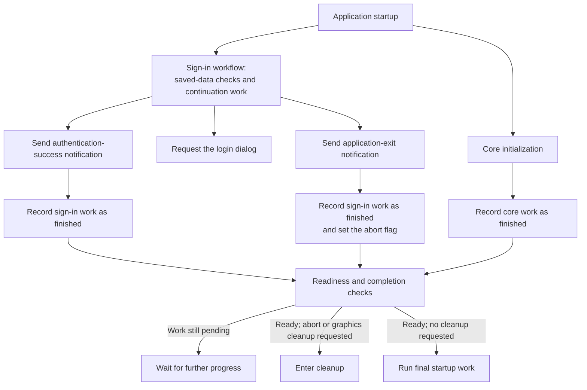

# Introduction 

We used Codex with the REA MCP to analyze how a desktop application enforces its licensing rules during startup, then determine how to modify the executable to bypass that enforcement. Through REA, Codex could inspect the binary and move between embedded text, cross-references, decompiled functions, and processor instructions. This article examines the patch it produced and its intended control-flow effects.

The application enforces licensing through several connected startup decisions. It loads saved account data, chooses whether to attempt saved sign-in, tries to refresh a stored token, can fall back to a login dialog, and later runs a warning check that can request application exit. Changing the first decision only moves execution into the next check, so the patch has to account for the path as a whole. The solution changes four points along that path. The first edit keeps startup on the saved-sign-in route after the initial rejection. The second redirects the login fallback into the existing continuation. The final two stop the warning path from turning that continuation into an application exit. 

The work behind a patch like this is reverse engineering: recovering how a compiled program behaves without its source code. The executable still contains instructions, text, data, and calls between functions, but most of the original names and explanations are gone. An investigator follows clues such as startup messages and setting names into the code, then traces values and branches until the program's decisions become clear. This has traditionally required experience with assembly, executable formats, and specialized tools. An agent can take on much of that work. The user describes the behavior they want to understand or change; the agent searches the binary, follows references, tests its interpretation against the instructions, and records the evidence behind its conclusions.

That lowers the skill floor for cracking. A user can describe the change they want and let an agent handle the reverse engineering. Work once reserved for specialists becomes something users can initiate themselves.

Software vendors have long relied partly on the cost of reverse engineering. Licensing rules enforced on the user's machine can be found and changed, but the required time and expertise have kept that work out of reach for most people. Agentic reverse engineering reduces that cost and makes those rules accessible to a much larger group.

> This fictional walkthrough is intended as an illustration. Names and identifying values are replaced with aliases, while the target's identity, addresses, and file offsets are omitted. It is not a turnkey patch. The purpose is to explain the technical ideas. Please respect software licenses and applicable laws.

### Aliases and redactions

This walkthrough replaces identifying names and values with descriptive aliases. The aliases describe what the recovered code does; they are not names from the original source code.

| Form | Meaning | Example |
|---|---|---|
| `PascalCase()` | Function alias | `StartupDecision()` |
| Names ending in `String` | Embedded-text alias | `SavedLoginSettingString` |
| `@Name` | Instruction, code-block, or data-location alias | `@RejectStartup` |
| `#Name` | Literal, selector, key, field, route, offset, state, or notification alias | `#WarningOperation` |
| `*` inside a value | An undisclosed portion of the original value | `0xC******9` |

## How the startup system works

Startup brings together sign-in work and core initialization. Sign-in work uses saved information, chooses whether to ask for login, and can issue success or exit notifications. Core initialization prepares the rest of the application. A completion check combines their recorded progress and decides whether to run the final startup work or enter cleanup.

### How startup reaches completion

Here is how startup works:



### Where we intervene

The four changes all sit inside "Sign-in workflow". Each removes a point where the application would otherwise stop, ask the user to sign in, or exit. Together, they steer startup away from "Request the login dialog" and "Send application-exit notification", allowing it to reach "Send authentication-success notification".

#### Change 1: continue after the initial rejection

Startup begins by deciding whether saved sign-in is worth attempting. It checks the saved account details and token. If any check fails, the application abandons that route.

We change that decision so the rejected path continues into saved sign-in instead. The application now makes the attempt even when its initial checks say not to.

#### Change 2: redirect "Request the login dialog"

Continuing into saved sign-in is not enough by itself. If the application cannot refresh the saved token or understand the response, it reaches "Request the login dialog".

We redirect that fallback into the existing sign-in continuation. Instead of stopping for manual login, the workflow keeps moving. It can now approach "Send authentication-success notification", although one more check can still send it toward "Send application-exit notification".

#### Change 3: skip the warning request in "Sign-in workflow"

Before sign-in can succeed, the continuation performs a warning check. It normally sends a request and inspects the response, which can cause the application to exit.

We skip that request so it cannot return a new warning. The warning check still runs, however, and may try to inspect an old or missing response. That is why the final change is also needed.

#### Change 4: end the warning check before "Send application-exit notification"

We change the warning check so it ends before inspecting that old or missing response. This prevents it from reaching "Send application-exit notification" and lets the sign-in continuation proceed toward "Send authentication-success notification".

## How the relevant startup code was identified

Startup messages and saved-setting names provided recognizable connections between the interface and the code responsible for saved sign-in. References to those strings identified candidate functions involved in deciding whether startup would attempt saved sign-in.

Strings containing `starting`, `sign`, `login`, and `authentication` provided candidates for inspection. A saved-login setting connected to code that reads the setting, while a diagnostic connected to code that advances the workflow. Each string's cross-references identify the instructions that use it, connecting the text to the functions examined below. We used Ghidra to inspect the binary's instructions and associate them with their enclosing functions. The table records those relationships.

| String alias | What its reference shows | Instruction reference | Function reached |
|---|---|---|---|
| `SavedLoginSettingString` | Reads the flag that enables saved sign-in | `@SavedLoginSettingRef` | `StartupDecision()` |
| `StartupStatusString` | Updates startup status | `@StartupStatusRef` | `StartupDecision()` |
| `SignInStatusString` | Updates sign-in status | `@SignInStatusRef` | `StartupDecision()` |
| `ProgressionDiagnosticString` | Identifies code that selects a workflow step | `@ProgressionDiagnosticRef` | `DispatchState()` |

The search narrows the problem to two parts of startup: the decision to attempt saved sign-in and the workflow that follows. From there, we trace each possible path to see where the application continues, asks for login, or exits. Those paths reveal where the changes need to be made.

## How to read the code excerpts

After locating the relevant functions, we used Ghidra to decode their machine-code bytes into assembly instructions. For each relevant function, we provide an assembly excerpt and equivalent pseudocode based on how values move through calls, comparisons, and branches. The pseudocode is not recovered source code; it restates the observed logic using descriptive aliases.

A few assembly concepts that are important to remember:

- A register is temporary storage inside the processor. Registers can hold function inputs, results, addresses, and intermediate values.
- `CALL` runs another function and then returns to the following instruction. A small result such as true or false is commonly returned in `AL` in this binary.
- `TEST` or `CMP` checks a value. A conditional jump such as `JZ` or `JNZ` chooses the next block from that result.
- `JMP` moves directly to another block. `RET` returns to the caller.

Here is an example. `CALL` runs `IsReady()`, which returns its result in `AL`. `TEST` checks whether that result is zero. If it is, `JZ` jumps to `@NotReady`, where `XOR EAX, EAX` sets the return value to zero. Otherwise, execution continues to `MOV EAX, 1`. `JMP` skips the other branch, and both paths meet at `RET`, which returns to the caller.


```nasm
CALL IsReady
TEST AL, AL
JZ   @NotReady

MOV  EAX, 1
JMP  @Done

@NotReady:
XOR  EAX, EAX

@Done:
RET
```

The equivalent pseudocode is:

```text
if IsReady():
    return 1

return 0
```

### Memory offsets

Source code refers to fields by name, such as `account.credential`. Compiled code usually reaches the same field by its position inside the object. An **offset** is the distance, in bytes, from the object's starting address:

```text
field_address = object_address + byte_offset
```

If the credential is stored at offset `0x30`, its address is `object_address + 0x30`. The `0x` prefix means the number is hexadecimal; `0x30` is 48 in decimal. The object may move in memory, but the field remains 48 bytes from its start.

In assembly, the object's address is often held in a register. Suppose `RDI` points to the object:

```nasm
LEA RCX, [RDI + 0x30]
```

`LEA` adds `0x30` to the address in `RDI` and places the result in `RCX`. In pseudocode:

```text
field_address = object_address + 0x30
```

An offset identifies a position, not what the field means. The same `+0x30` can refer to different fields in different kinds of objects. We infer its meaning from how the value is used. If code treats it as text and checks whether it is empty, for example, that suggests the field contains a string. Following the same field through different functions lets us connect where it is filled to where it is later checked.


## Saved information used by the sign-in path

Saved sign-in is not a single check. Startup first decides whether the saved information is good enough to try. If it is, the application starts a worker that makes the actual sign-in attempt. That attempt can still fail and fall back to "Request the login dialog".

The saved information lives in the Windows registry, a key-value store that applications use to keep data between runs. We call the location containing the saved-login flag and account record `#LoginSettings`. The token is stored separately under `#TokenSettings`.

| Input | What it provides |
|---|---|
| Saved-login flag | Whether the application should try saved sign-in. |
| Saved account record | The login identifier and credential. |
| Saved token | The token checked and processed during sign-in. |

The initial screening reads these values to decide whether to start the worker. The worker then reads some of them again and tries to process the token. Passing the screening therefore begins saved sign-in; it does not complete it.

This distinction explains the first two changes. Change 1 gets past the initial screening and starts the worker. Change 2 handles the later fallback when the worker cannot finish the sign-in attempt.

### Fields in the saved account record

On first access, the application reads the account record from `#LoginSettings`, decodes it, and copies its fields into the account object used by startup. The saved-login flag selects `#DefaultSavedRecordKey` when false. When true, the reader tries `#PrimarySavedRecordKey` first and uses `#FallbackSavedRecordKey` if that value is empty.

`LoadSavedFields()` checks the record's structure and checksum. `ImportSavedFields()` copies the decoded values into the account object. Fields 1 and 2 become the identifier and credential that `MissingLoginFields()` checks.

`BuildSavedFields()` writes twelve fields in this order:

| Field | Meaning | Source and essential use |
|---:|---|---|
| 1 | Login or license identifier | UI input or response `#LicenseIdentifierResponseField`. Both startup and the worker require a nonempty value. The alive request sends it as `#UserIdentifierRequestField`. |
| 2 | Credential string | The login form supplies a password whose lowercase MD5 digest is stored; the response handler copies `#CredentialResponseField` directly. Both checks require a nonempty value. |
| 3 | Product ID | The configured product ID. The importer overwrites the loaded value with that configuration. |
| 4 | License edition | Response `#LicenseEditionResponseField`, parsed as an integer and sent as `#LicenseEditionRequestField` by the alive request. `#LicenseTypeResponseField` is a separate response value. |
| ... | ... | ... |
| 6 | Serial-related value | Initialized from `#SerialValueKey`; a loaded record can replace it. |
| ... | ... | ... |

## Change 1: continue after the initial rejection

Startup normally reaches the saved-login worker only when three conditions are met: saved sign-in is enabled, the saved account contains the required fields, and the stored token passes its local checks. If any condition fails, startup records a rejection and takes another path.

Change 1 alters that shared rejection outcome. The checks still run and the saved information remains untouched, but rejection now leads to the saved-login worker instead of diverting startup elsewhere.

### The initial startup decision

The reference to `SavedLoginSettingString` reads the saved-login flag. If the flag is enabled, startup checks the saved account and then the stored token:

| Check | What startup requires |
|---|---|
| Saved-login setting | Saved sign-in is enabled |
| `MissingLoginFields()` | Both account fields are present |
| `CheckStoredToken()` | The saved token passes its local checks |

`MissingLoginFields()` checks that the saved account contains both an identifier and a credential. `CheckStoredToken()` then checks the separately stored token, including its expected contents and expiration. These checks establish what the initial decision means, but Change 1 does not alter either function.

In pseudocode, the original decision is:

```text
StartupDecision(startup_object):
    take_sign_in_path = false
    if saved_login_flag is true:
        if MissingLoginFields(account_object) == 0:
            if CheckStoredToken(startup_object) != 0:
                take_sign_in_path = true

    clean up temporary values
    if take_sign_in_path:
        schedule the saved-login worker
    else:
        RemoveSavedRecord()
        continue the alternate startup path
```

The checks stop at the first failure, but every failure reaches the same rejection block. In the assembly, `AL` holds the latest result and `DIL` keeps the decision while temporary data is cleaned up:

```nasm
    ; AL holds the saved-login flag.
    TEST AL, AL
    JZ   @RejectStartup
    ; Obtain the account object and pass it to the next call.
    CALL MissingLoginFields()
    TEST AL, AL
    JNZ  @RejectStartup
    MOV  RCX, RBX
    CALL CheckStoredToken()
    TEST AL, AL
    JZ   @RejectStartup
    MOV  DIL, 1
    JMP  @StartupCleanup
@RejectStartup:
    XOR  DIL, DIL
@StartupCleanup:
    ; Destroy the temporary settings value.
    TEST DIL, DIL
    JZ   @AlternateStartup
    ; Continue into the sign-in branch and schedule its work.
```

Each failed check jumps to `@RejectStartup`, where `DIL` is cleared. A successful path sets `DIL` to one instead. After cleanup, startup tests this value to decide whether to schedule the saved-login worker.

### How the rejection assignment changes

The patch changes the value recorded by the rejection block:

```nasm
; Original
XOR DIL, DIL

; Changed
MOV DIL, 1
```

The replacement makes the shared rejection block record the same decision as the accepted path. Startup therefore schedules the saved-login worker regardless of the initial result. This does not complete sign-in: the worker performs further processing and can still fall back to "Request the login dialog", which is addressed by Change 2.

## Change 2: redirect the login-dialog fallback

Change 1 ensures that startup reaches `SavedLoginWorker()`, but the worker can still abandon automatic sign-in and request the login dialog. This happens when it cannot obtain a usable replacement token. Later response processing can reach the same fallback when expected data is missing or unrecognized.

Both routes enter the same dispatcher block. Change 2 redirects that block into the existing sign-in continuation, before `#LoginDialogNotification` is emitted.

### How sign-in reaches the fallback

The worker calls `ProcessStoredToken()` after checking the saved-login flag and account fields. A nonzero result continues token and response processing. If the result is nonzero, the worker continues with token and response processing.

```nasm
    CALL ProcessStoredToken()
    TEST AL, AL
    JNZ  @WorkerContinues
    CALL RemoveSavedRecord()
    MOV  EDX, 2                 ; LOGIN_DIALOG_STEP
    ; Pass the workflow object as the first input.
    CALL DispatchState()
    ; Clean up and return from this path.
@WorkerContinues:
    ; Continue token and response processing.
```

`TEST AL, AL` checks the result. `JNZ` takes the worker's continuation when the result is nonzero. Otherwise, the worker calls `RemoveSavedRecord()` and passes selector `2` to `DispatchState()`.

After a nonzero result, the worker installs the returned token and calls `ProcessSignInResponse()`. That function can make the same request when it cannot use the returned data:

```nasm
    MOV EDX, 2                 ; LOGIN_DIALOG_STEP
    MOV RCX, R14               ; workflow object
    CALL DispatchState()
```

These failures begin in different places, but both reach the same dispatcher block. On the worker's failed-token route, `RemoveSavedRecord()` has already run before the dispatcher is called.

### How the dispatcher selects the blocks

`DispatchState()` selects a block of code from the requested step. It subtracts one from the selector, uses the result to find a destination in a table, and jumps there.

| Requested step | Selector | Destination |
|---|---:|---|
| "Request the login dialog" | `2` | `@LoginDialogBlock` |
| "Begin the sign-in continuation" | `1` | `@SignInContinuation` |

```nasm
@DispatchIndex:
    LEA  EAX, [R14 - 1]
    CMP  EAX, 0x0B
    JA   @DispatchReturn
    CDQE
    LEA  RDX, [@ImageBase]
    MOV  ECX, dword ptr [RDX + RAX*4 + #StateTableOffset]
    ADD  RCX, RDX
    JMP  RCX
```

`R14D` holds the selector. `LEA` turns it into a zero-based table index, and `JA` rejects values outside the supported range. The table entry and image base produce the address used by `JMP RCX`. Tracing selector `2` leads to `@LoginDialogBlock`; selector `1` leads to `@SignInContinuation`.

The login-dialog block prepares and emits `#LoginDialogNotification`. The login-dialog block prepares and emits `#LoginDialogNotification`. The continuation resumes the sign-in workflow and can eventually emit `#AuthenticationSuccessNotification`.

### How a jump replaces the login-dialog call

The edit replaces the first instruction of `@LoginDialogBlock`:

```nasm
; Original at @LoginDialogBlock
CALL GetAccountContext()

; Replacement
JMP @SignInContinuation
```

The original `CALL` begins the login-dialog work and then returns to the rest of that block. The replacement `JMP` enters the continuation before the login-dialog work begins or `#LoginDialogNotification` is emitted.

Because the edit is inside the dispatcher, it applies to both routes that request the dialog. It does not undo `RemoveSavedRecord()` when the worker has already called it. Startup now continues through the sign-in workflow without displaying the login dialog, but the continuation still contains a warning check that can request application exit. Changes 3 and 4 address that check.

## Change 3: return from the shared helper

Change 2 sends execution into the sign-in continuation. Before that continuation can finish, it calls `WarningTransition()`, which sends a request to `#WarningRouteString`. A nonzero result triggers response inspection, which can eventually request application exit.

Change 3 stops the request itself. It places an immediate return at the entry to `SharedRequest()`, so the helper returns before creating a request or changing the stored response. The surrounding warning check remains in place.

### How the warning check reaches the request helper

`WarningTransition()` first checks for a client. If one exists, it calls `WarningRequest()` and tests the returned byte:

```text
WarningTransition(workflow_object):
    client = read pointer at (workflow_object + #ClientOffset)
    if client == null:
        return
    result = WarningRequest(client)
    if result == 0:
        return
    inspect the stored response and possibly request application exit

WarningRequest(client):
    route = decode #WarningRouteString
    result = SharedRequest(client, route, #WarningOperation)
    release route
    return result
```

```nasm
    MOV  RCX, qword ptr [RCX + #ClientOffset]
    TEST RCX, RCX
    JZ   @WarningReturn
    CALL WarningRequest()
    TEST AL, AL
    JZ   @WarningReturn
    ; Response inspection begins here.
```

The first `JZ` ends the check when no client is available. The second does the same for a zero request result. A nonzero result continues into response inspection. Change 3 alters the request below this call, but it does not remove this decision.

### The encoded route and the helper's work

The route is assembled at runtime rather than stored as plaintext. `WarningRequest()` stores the operation selector `#WarningOperation` and two partially masked constants before calling `SharedRequest()`:

```nasm
    MOV  dword ptr [RBP - 0x29], #WarningOperation
    MOV  dword ptr [RBP + 0x17], 0xC******9
    MOV  dword ptr [RBP + 0x1B], 0xD******4
    ; Decode the eight stored bytes into temporary string storage.
    XOR  EDX, EDX
@DecodeRoute:
    LEA  ECX, [RDX - #RouteDecodeBias]
    XOR  CL, byte ptr [RBP + RDX + 0x17]
    ; Select the destination in RAX.
    MOV  byte ptr [RAX + RDX], CL
    INC  RDX
    CMP  RDX, 8
    JNC  @RouteReady
    ; Refresh temporary-string metadata and repeat.
    JMP  @DecodeRoute
@RouteReady:
    ; Convert the decoded bytes into a QString and clean up temporaries.
    LEA  R8, [RBP - 0x29]
    LEA  RDX, [RBP - 0x21]
    MOV  RCX, RBX
    CALL SharedRequest()
```

Reading the constants in memory order and applying the XOR loop produces `#WarningRouteString`. The wrapper passes that route, `#WarningOperation`, and the client to `SharedRequest()`.

`SharedRequest()` normally clears the response map at `client + #ResponseMapOffset`, prepares the request, and reads the response. It returns zero when that work fails and one when it produces a usable response map.

### How the immediate return affects the caller

Change 3 replaces the first instruction at the helper's entry:

```nasm
; Original instruction at SharedRequest() entry
MOV qword ptr [RSP + 8], RBX

; Replacement
RET
```

The replacement runs before `SharedRequest()` changes the stack or performs any work. `RET` therefore returns directly to `WarningRequest()`, which continues its normal cleanup.

The wrapper preserves the byte in `AL` while it destroys the temporary route string:

```nasm
    CALL SharedRequest()
    MOVZX EBX, AL
    ; Destroy the route QString.
    MOVZX EAX, BL
    ; Remaining cleanup on the normal return path preserves the result.
```

The immediate return does not assign a result to `AL`. The wrapper preserves the byte already there and returns it to `WarningTransition()`, where the warning-result test still runs.

After Change 3, the warning call produces no fresh response. An existing response map remains unchanged, while a new client's map remains empty. Because `SharedRequest()` is shared, other callers that enter it also return immediately. The remaining problem is the nonzero byte returned to `WarningTransition()`: it still sends execution into response inspection. Change 4 changes that decision.

## Change 4: reverse the warning-result branch

Change 3 prevents `SharedRequest()` from making the warning request, but it does not set a return value. On the examined path, `WarningRequest()` consequently returns the value already left in `AL`: `2`.

The original warning check returns only for zero. A value of `2` therefore sends execution into response inspection even though Change 3 produced no fresh response. That inspection can reach "Send application-exit notification". Change 4 reverses the branch, causing the warning check to end for the inherited nonzero value.

### The branch left behind by Change 3

`WarningTransition()` first checks for a client, then calls `WarningRequest()` and tests its result:

```text
client = read pointer at (workflow_object + #ClientOffset)
if client == null: return
result = WarningRequest(client)
if result == 0: return
response = read map at (client + #ResponseMapOffset)
if the response is rejected:
    DispatchState(workflow_object, #ApplicationExitState)
```

```nasm
MOV  RSI, RCX
; ... initialize local state ...
MOV  RCX, qword ptr [RCX + #ClientOffset] ; Load the client.
TEST RCX, RCX
JZ   @WarningReturn
CALL WarningRequest()
TEST AL, AL
JZ   @WarningReturn
MOV  RAX, qword ptr [RSI + #ClientOffset] ; Reload the client.
MOV  RCX, qword ptr [RAX + #ResponseMapOffset] ; Read the response map.
```

The first `JZ` handles a missing client. The second tests the result of `WarningRequest()`. Zero returns; nonzero falls through to the response map at `client + #ResponseMapOffset`.

The response checks record rejection in `BL`. A nonzero flag passes `#ApplicationExitState` to `DispatchState()`, reaching "Send application-exit notification":

```nasm
; A passed response reaches this assignment.
XOR BL, BL
JMP @WarningChecksDone
@WarningRejected:
MOV BL, 1
@WarningChecksDone:
; ... clean up temporary response values ...
TEST BL, BL
JZ   @WarningCleanup
MOV  EDX, #ApplicationExitState
MOV  RCX, RSI
CALL DispatchState()
@WarningCleanup:
; ... release the retained response map ...
@WarningReturn:
; ... restore registers and return ...
```

### Reversing the branch

Change 4 reverses the jump immediately before response inspection:

```nasm
; Original
JZ   @WarningReturn

; Replacement
JNZ  @WarningReturn
```

The original jump returns for zero. The replacement returns for nonzero, before the response map is read. A zero result now falls through to the unchanged response checks.

### Why the returned byte is 2

`RET` does not create a return value. It leaves `AL` holding the low byte of the value already in `EAX`. In this wrapper, that value comes from cleanup of the temporary `#WarningRouteString` immediately before the call to `SharedRequest()`.

Qt keeps a reference count for shared string storage. The route string has two owners at this point. Destroying the temporary reduces the count and leaves its previous value in `EAX`:

```nasm
; Non-null storage path in QString::~QString()
MOV  EAX, 0xffffffff
LOCK XADD dword ptr [RDX], EAX
CMP  EAX, 1
JNZ  destructor_return
```

`XADD` reduces the count from two to one and places the old count, `2`, in `EAX`. The intervening instructions preserve that value, and Change 3's immediate `RET` leaves it untouched. The wrapper then saves the byte across its remaining cleanup and restores it for `WarningTransition()`:

```nasm
CALL SharedRequest()
MOVZX EBX, AL
; Destroy the surviving route string.
MOVZX EAX, BL
```

Change 4's `JNZ` now takes the early return for that value. The stale or missing response is never inspected, no exit is requested by this warning check, and the sign-in continuation can proceed toward "Send authentication-success notification".

## How the startup changes work together

The changes form one route through startup. Changes 1 and 2 keep sign-in moving when the saved information is rejected. Changes 3 and 4 then prevent the warning check inside the continuation from turning that route into an application exit.

The byte changes below apply to the examined build. 

1. [Change 1: continue after the initial rejection](#change-1-continue-after-the-initial-rejection)

   - Site: `@RejectStartup`
   - Role: sends the initial rejection to the saved-login worker.
   - Edit: replace `40 32 FF` with `40 B7 01`

2. [Change 2: redirect the login-dialog fallback](#change-2-redirect-the-login-dialog-fallback)

   - Site: `@LoginDialogBlock`
   - Role: sends the login-dialog fallback into `@SignInContinuation`.
   - Edit: replace `E8 90 FC FF FF` with `E9 23 FF FF FF`

3. [Change 3: return from the shared helper](#change-3-return-from-the-shared-helper)

   - Site: `SharedRequest()` entry
   - Role: stops the warning request before it creates or replaces a response.
   - Edit: replace the leading byte `48` with `C3`
   - Detail: the original instruction is `48 89 5C 24 08`; after the new `RET`, the remaining bytes are not reached through the function entry.

4. [Change 4: reverse the warning-result branch](#change-4-reverse-the-warning-result-branch)

   - Site: `@WarningResultTest`
   - Role: returns from the warning check before the stale or missing response is inspected.
   - Edit: replace `0F 84 F1 01 00 00` with `0F 85 F1 01 00 00`

The first two changes handle consecutive fallbacks. Change 1 reaches the saved-login worker, and Change 2 redirects the worker's later login-dialog fallback into the sign-in continuation.

The next two changes handle the warning check inside that continuation. Change 3 prevents the request from running, and Change 4 makes the resulting nonzero byte end the check before response inspection.

Taken together, the changes trace a route through startup: from the saved-login worker, through the existing continuation, and past the warning-related exit path.

## How the saved account record is encoded

The earlier field table describes the record's logical contents. In the registry, those fields are stored together in one transformed string rather than as readable values. The application encodes each field, joins the results, adds a checksum, and then encodes the complete record again.

### Encoding a string

> Some constants and worked values in this section have been changed to avoid identifying the application. The structure of the process is unchanged.

`EncodeStoredString()` transforms text in two stages. It first converts each UTF-16 code unit into four lowercase hexadecimal digits, then replaces every digit according to this table:

```text
input:   0123456789abcdef
output:  af7c9eb2d4063851
```

The substitution reverses itself. For example, `0` becomes `a`, and `a` becomes `0`. Applying the same table again restores the original hexadecimal digits.

The encoder then rearranges the resulting characters through a series of swaps. For each character position, it reads the next value from the 20-entry table at `@StringPermutation`, calculates another position, and swaps the two characters:

```text
swap_position = ((table[position % 20] + position) & 0xffffffff) % length
```

The table repeats after twenty positions. `& 0xffffffff` reproduces the program's 32-bit unsigned addition, while `% length` keeps the calculated position inside the string.

`DecodeStoredString()` reverses the swaps, starting with the last one, and then applies the hexadecimal substitution again. Reversing the swap order restores the earlier character positions before the original digits are reconstructed. The [function and code-label appendix](#appendix) lists both functions and the permutation table by alias.

### Complete record format

The application calls `EncodeStoredString()` at two different levels. First, it encodes each of the twelve field values separately. It joins those encoded fields with spaces, including a space after the final field, and calculates MD5 over that entire joined string. The checksum itself is not encoded separately: its 32 lowercase hexadecimal digits are appended directly to the joined fields. The application then passes the complete fields-and-checksum string through `EncodeStoredString()` a second time. The result of that outer encoding is stored in the registry.

```text
twelve field values
    -> encode each field separately
    -> join the twelve encoded fields, with a space after each one
    -> calculate MD5 over that joined text as ASCII bytes
    -> append the unencoded checksum
    -> encode the complete fields-and-checksum string
    -> store the result in the registry
```

Here's how that works with a single field.

1. Encode the field `AB`:

   ```text
   AB
       -> UTF-16 hexadecimal: 00410042
       -> substitution:       aa9faa97
       -> character swaps:    a9aa7fa9
   ```

2. Add the trailing space to form the checksum input. The `\s` makes that otherwise invisible character explicit:

   ```text
   a9aa7fa9\s
   ```

3. Calculate MD5 over those exact ASCII bytes:

   ```text
   f165ec9e97ddaa3985491b452fff809c
   ```

4. Append the checksum without encoding it separately:

   ```text
   a9aa7fa9 f165ec9e97ddaa3985491b452fff809c
   ```

5. Encode that complete string again:

   ```text
   dbaa4f4caaafaaabafccbbbaafabaaaaaaafabcb7c2aa4acaaaeaaa4aecbbcbaaeabaaa2aaa9afbbcbcaa4abaaacaaadaecccc9aafacaaa4aaa7a9cccb4aa9acaaa7aaababcbcbfaaeabaaaaaaacaaaccbba
   ```

When the record is read, the application reverses the outer encoding, separates the fields and checksum, verifies the checksum, and then decodes the individual fields.

# Conclusion

This article uses a licensing-control case study to demonstrate something broader: modifying software without its source code. The same ability to trace a decision and change its outcome can support bug fixes, compatibility patches, altered workflows, and repairs to abandoned applications.

Compiled software has always been modifiable. Doing so required expertise that most users could never justify acquiring. AI lowers that barrier by helping reconstruct how a program works and translating an intended change into specific edits. A user can increasingly begin with a description of the behavior they want.

Software distributed as a finished product becomes material that its users can examine and reshape. The practical lifespan of an application could extend beyond its vendor's support. A small community could maintain changes that never made commercial sense for the original developer. Personal modifications could become ordinary.

As these tools improve, users may come to expect greater control over the applications they run. That changes the relationship between software creators and software users. Shipping an executable gives people a working implementation. AI makes it easier for them to decide what that implementation should do next.

# Appendix

The application-specific aliases used in the walkthrough are listed below. They describe inferred roles, not original source names. Generic names used only in teaching examples are omitted. Build-specific addresses and file offsets are also omitted.

## Function aliases

| Function alias | Meaning |
|---|---|
| `StartupDecision()` | Screens saved state and selects the saved-sign-in or alternate startup path |
| `DispatchState()` | Routes a workflow selector to the corresponding code block |
| `WarningTransition()` | Runs the warning check and can request application exit |
| `WarningRequest()` | Constructs the warning route and calls `SharedRequest()` |
| `SharedRequest()` | Performs the shared client request and stores its response map |
| `MissingLoginFields()` | Returns one if the identifier or credential is empty |
| `CheckStoredToken()` | Validates the separately stored token |
| `DecodeStoredString()` | Decodes stored strings |
| `EncodeStoredString()` | Encodes strings for storage |
| `RemoveSavedRecord()` | Removes the selected saved account record |
| `LoadSavedFields()` | Selects, parses, and decodes a saved record into positional fields |
| `ImportSavedFields()` | Imports decoded fields into account state |
| `SavedLoginWorker()` | Rechecks saved-login fields and token |
| `ProcessStoredToken()` | Attempts to obtain a usable replacement token |
| `ProcessSignInResponse()` | Handles response data and can request the login dialog |
| `BuildSavedFields()` | Builds the ordered twelve-field list for storage |
| `GetAccountContext()` | Supplies account context to the login-dialog block |

## String aliases

| String alias | Meaning |
|---|---|
| `SavedLoginSettingString` | Embedded text used to locate the saved-login setting read |
| `StartupStatusString` | Embedded startup-status text referenced by startup decision code |
| `SignInStatusString` | Embedded sign-in-status text referenced by startup decision code |
| `ProgressionDiagnosticString` | Embedded diagnostic text referenced by workflow dispatch code |

## Code-label aliases

| Code-label alias | Meaning |
|---|---|
| `@SavedLoginSettingRef` | Instruction that references `SavedLoginSettingString` |
| `@StartupStatusRef` | Instruction that references `StartupStatusString` |
| `@SignInStatusRef` | Instruction that references `SignInStatusString` |
| `@ProgressionDiagnosticRef` | Instruction that references `ProgressionDiagnosticString` |
| `@RejectStartup` | Clears the startup decision flag after an initial check fails |
| `@StartupCleanup` | Cleans up the temporary setting value before route selection |
| `@WorkerContinues` | Continues the worker after a nonzero token-processing result |
| `@AlternateStartup` | Handles startup when the saved-sign-in route is not selected |
| `@DispatchIndex` | Converts the workflow selector into a jump-table index |
| `@ImageBase` | Identifies the image base added to the table displacement |
| `@SignInContinuation` | Begins the sign-in continuation block |
| `@LoginDialogBlock` | Begins the login-dialog path |
| `@DispatchReturn` | Exits the dispatcher |
| `@WarningReturn` | Exits `WarningTransition()` |
| `@WarningResultTest` | Branches on the byte returned by `WarningRequest()` |
| `@WarningRejected` | Records a rejected warning response |
| `@WarningChecksDone` | Begins shared response cleanup after the result is set |
| `@DecodeRoute` | Decodes the warning route one byte at a time |
| `@RouteReady` | Continues once the warning route is complete |
| `@WarningCleanup` | Releases the retained response map |
| `@StringPermutation` | Identifies the twenty-entry permutation table used by the string encoder |

## Value aliases

| Value alias | Meaning |
|---|---|
| `#WarningOperation` | Operation selector passed to `SharedRequest()` for the warning check |
| `#WarningRouteString` | Route constructed and used by the warning request |
| `#RouteDecodeBias` | Numeric bias subtracted from the byte position before XOR decoding |
| `#LoginDialogNotification` | Notification requesting the login dialog |
| `#AuthenticationSuccessNotification` | Notification reporting successful authentication and continuation |
| `#LoginSettings` | Registry location containing saved-login state |
| `#TokenSettings` | Registry location containing the saved token |
| `#DefaultSavedRecordKey` | Saved-record key selected when saved sign-in is disabled |
| `#PrimarySavedRecordKey` | Saved-record key tried first when saved sign-in is enabled |
| `#FallbackSavedRecordKey` | Saved-record key used when the primary value is empty |
| `#LicenseIdentifierResponseField` | Response field containing the login or license identifier |
| `#UserIdentifierRequestField` | Request field carrying the login or license identifier |
| `#CredentialResponseField` | Response field containing the credential string |
| `#LicenseEditionResponseField` | Response field containing the license edition |
| `#LicenseEditionRequestField` | Request field carrying the license edition |
| `#LicenseTypeResponseField` | Response field containing the license type |
| `#SerialValueKey` | Key for the serial-related value |
| `#ClientOffset` | Byte offset of the client pointer within the workflow object |
| `#ResponseMapOffset` | Byte offset of the response map within the client object |
| `#StateTableOffset` | Displacement from the image base to the dispatcher jump table |
| `#ApplicationExitState` | Dispatcher selector that requests application exit |

